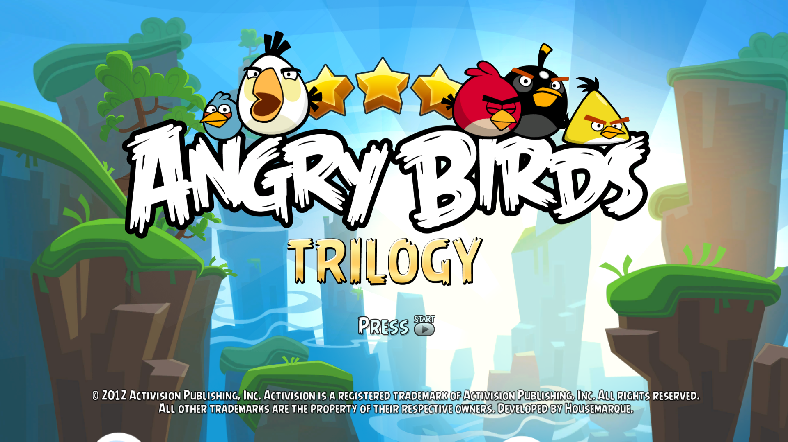
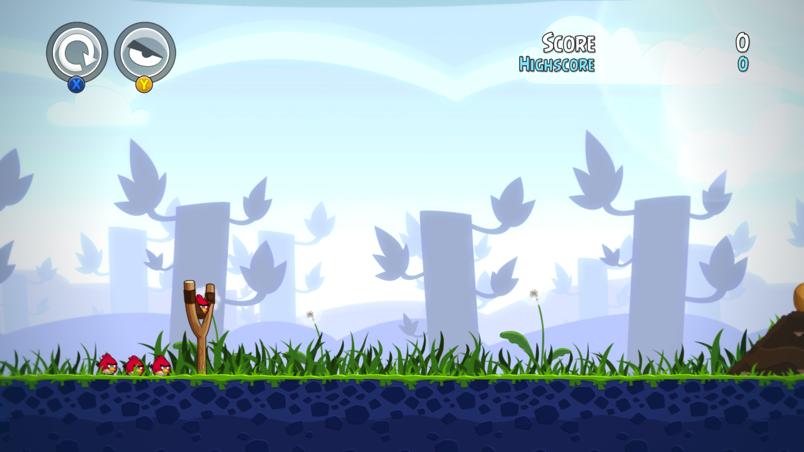

<p align="center">
  
  
  
</p>


# ReHatched-NX

<p align="center">
  <strong>Native Nintendo Switch port of Angry Birds Trilogy (Xbox 360) via static recompilation</strong>
</p>

<p align="center">
  <a href="#how-it-came-to-be">Origin</a> •
  <a href="#how-the-port-works">Architecture</a> •
  <a href="#how-to-build">Building</a> •
  <a href="#running-on-switch">Running</a> •
  <a href="#credits">Credits</a> •
  <a href="#licensing--legal">Licensing</a>
</p>

---

## Overview

**ReHatched-NX** is a native Nintendo Switch port of **Angry Birds Trilogy** (Xbox 360, Title ID `415608E4`, Media ID `1A15DA04`). Utilizing the PC static recompilation foundation of Angry Birds Trilogy from the [Re-Hatched Collection](https://github.com/TekRantGaming/angry-birds-re-hatched-collection) by TekRantGaming, this project translates the PowerPC guest executable into native 64-bit ARM code and pairs it with a Direct3D-level translation layer running on the Switch's low-overhead **deko3d** graphics API.

Unlike traditional emulation (which interprets or JIT-compiles guest machine instructions and simulates GPU microarchitecture in real time), ReHatched-NX translates the game's executable ahead-of-time into high-performance C++ using the [ReXGlue SDK](https://github.com/rexglue/rexglue-sdk). The game runs natively at full speed on the Switch hardware with lower latency, full frame pacing, and drastically reduced power consumption compared to an emulator.

This technically *does* have support for Angry Birds Space like the Re-Hatched collection supports. I didn't add it because I didn't feel like integrating another 6.8gb ISO file into this project. I left some functionality there; the calls and graphics should not be too far off from the other 3 games from Angry Birds Trilogy. It just isn't built or included. If you would like to compile it as well, my guess is it would either have to be a separate .NRO file, or you would have to make a launcher app to switch between the two. I don't care enough for it. If you do get it working, please do not hesitate to let me know, I'd be interested to see it working.

### Note:
This was built on CachyOS linux. I have not tested it on Windows, macOS or any other distribution. If you need support for any of these operating systems, open up an issue on GitHub, or contact me some way...

> [!IMPORTANT]
> **No game assets or proprietary code are contained in this repository.** To build and play ReHatched-NX, you must provide your own legally obtained copy of *Angry Birds Trilogy* for Xbox 360. All code generation, asset extraction, and shader translation steps occur locally on your machine.

---

Detailed engineering logs and memory offsets are documented in [docs/rehatched-notes.md](docs/rehatched-notes.md).

### 1. CPU Recompilation (ReXGlue)
The guest PowerPC 64-bit code is disassembled and translated ahead-of-time into C++ functions. A multi-stage post-codegen pipeline ([tools/post_codegen.py](tools/post_codegen.py)) performs:
- **Guest CAS & Atomic Rewriting:** Translates PowerPC `lwarx`/`stwcx` reservation idioms into native host atomics.
- **Float Control Flow (CG-13):** Eliminates redundant `msr fpcr` state-switch instructions across scalar and vector code paths by leveraging unified host flush mode.
- **Register Liveness & Native Shards:** Inlines hot guest leaf functions and optimizes register assignments to reduce stack spilling.

### 2. Graphics Pipeline (reNut + plume + deko3d)
Rather than emulating the Xbox 360's custom Xenos GPU (which would incur prohibitive overhead on the Switch's 1.0 GHz Cortex-A57 CPU), ReHatched-NX uses a high-level API translation model:
- Direct3D 9 calls from the game are intercepted by reNut.
- reNut interacts with **plume**, an abstraction layer that targets Nintendo Switch's proprietary **deko3d** graphics library.
- By binding directly to deko3d, draw commands are submitted to the hardware command queue with minimal driver overhead, bypassing Vulkan layers and avoiding EDRAM tile emulation where possible.
- On PC platforms for debugging and testing, plume binds to **Vulkan**.

### 3. Shader Architecture
The Xbox 360 utilizes custom Xenos microcode. ReHatched-NX translates all game shaders during the build phase:
1. Microcode is extracted from the executable containers into `out/renut_shader_dump`.
2. [XenosRecomp](app/thirdparty/reblue-XenosRecomp) compiles microcode to SPIR-V intermediate representation.
3. [SPIRV-Cross](https://github.com/KhronosGroup/SPIRV-Cross) translates SPIR-V into GLSL tailored for deko3d.
4. Custom passes perform early-alpha discard optimization, instruction scheduling, and syntax translation.
5. All translated shaders are compiled with [uam](app/thirdparty/uam) and packed directly into the Switch executable, eliminating any in-game runtime shader compilation stutter.

### 4. Audio & Asset Subsystems
- **Audio:** Xbox 360 XMA audio packets are parsed by the ReXGlue SDK audio subsystem and decompressed in real time using FFmpeg (`libavcodec`).
- **Filesystem / VFS:** Game archives (`audio.pck`, `database.xmplr`, `stream.dat`, `speech/`, `videos/`) are mounted via a zero-copy virtual filesystem layer.

---

## How to Build

### Prerequisites

#### Linux (Ubuntu/Debian-based)
```bash
sudo apt update
sudo apt install build-essential cmake ninja-build clang lld python3 python3-pip
pip3 install xxhash pillow
```

#### DevkitPro (for Nintendo Switch targets)
1. Install [devkitPro pacman](https://devkitpro.org/wiki/Getting_Started).
2. Install the Nintendo Switch development packages:
   ```bash
   sudo dkp-pacman -S switch-dev switch-portlibs deko3d uam
   ```
3. Ensure environment variables are set:
   ```bash
   export DEVKITPRO=/opt/devkitpro
   export DEVKITA64=/opt/devkitpro/devkitA64
   ```

---

### Step 1: Provide Game Assets
Extract your legally obtained *Angry Birds Trilogy* Xbox 360 disc image:
```bash
# Place your extracted game directory containing default.xex and data files at:
# /path/to/birds/game

# Symlink it into the app/assets directory:
ln -s /path/to/birds/game /path/to/birds/rehatched-nx/app/assets
```

---

### Step 2: Build Host Tools & Perform Code Generation
1. Build the host `rexglue` compiler:
   ```bash
   cd sdk
   cmake -B build-host -G Ninja -DCMAKE_BUILD_TYPE=Release
   cmake --build build-host --target rexglue
   cd ..
   ```
2. Run code generation over the executable:
   ```bash
   bash tools/codegen.sh
   python3 tools/post_codegen.py
   ```
   *This outputs generated C++ files in `app/generated/` and verifies calling conventions.*

---

### Step 3: Translate & Package Shaders
1. Dump the shader microcode from the image:
   ```bash
   python3 tools/renut_shader_dump.py --image out/renut_image.bin --out out/renut_shader_dump
   ```
2. Build the shader translator and package the deko3d binaries:
   ```bash
   bash tools/switch_shaders.sh
   ```

---

### Step 4: Build the Nintendo Switch NRO
Configure and build with devkitA64 toolchain:
```bash
cmake -S app -B app/out/switch -G Ninja \
  -DCMAKE_BUILD_TYPE=Release \
  -DCMAKE_TOOLCHAIN_FILE=tools/switch/cmake/switch-devkitA64.cmake

cmake --build app/out/switch -j$(nproc)
```
The resulting executable will be at `app/out/switch/rehatched-nx.nro`.

---

### Step 5: (Optional) Build for PC (Linux / Vulkan)
For debugging, RenderDoc profiling, or testing on PC:
```bash
cmake -S app -B app/out/pc_host -G Ninja \
  -DCMAKE_BUILD_TYPE=Release \
  -DREXGLUE_USE_VULKAN=ON \
  -DREXGLUE_USE_D3D12=OFF

cmake --build app/out/pc_host -j$(nproc)
```

---

## Running on Switch
`Note: This requires a Switch that has been modchipped or uses the Fusée Gelée hardware exploit to install custom firmware. This cannot be run on a stock Switch.`
1. Copy the build output and configuration files to your SD card:
   ```text
   sdmc:/
   └── switch/
       └── rehatched-nx/
           ├── rehatched-nx.nro          <-- Compiled executable
           ├── rehatched.toml             <-- Configuration settings
           └── (game assets or installer package)
   ```
2. Launch through Atmosphere custom firmware via the Homebrew Menu (holding R on an installed title for full RAM access is recommended).

### Configuration Options
Settings can be adjusted in `rehatched.toml`:
- `input_xbox_layout`: Set to `false` for standard Nintendo Switch face button orientation (A on the right, B on bottom), or `true` for original Xbox layout.
- `rehatched_keep_unused_targets`: Set to `1` (enabled by default) to keep depth targets active across surface header transitions and eliminate background flickering.
- `banjo_renut_smaa`: Toggle post-processing subpixel morphological antialiasing.

---

## Project Structure

| Directory | Purpose |
|---|---|
| [`app/`](app/) | Game layer configuration, reNut Direct3D 9 renderer, and backend integrations |
| [`app/src/renut_engine/gpu`](app/src/renut_engine/gpu) | GPU rendering backend (Direct3D hooks, surfaces, draw passes) |
| [`app/thirdparty/plume`](app/thirdparty/plume) | Hardware abstraction layer for deko3d (Switch) and Vulkan (PC) |
| [`app/thirdparty/reblue-XenosRecomp`](app/thirdparty/reblue-XenosRecomp) | Fork of XenosRecomp for shader microcode translation |
| [`sdk/`](sdk/) | ReXGlue SDK including Horizon/Switch OS abstractions, memory manager, and audio |
| [`tools/`](tools/) | Code generation, shader translation, Ryujinx test runners, and RenderDoc automation |
| [`docs/`](docs/) | In-depth engineering notes, hook specifications, and architectural documentation |

---

## Credits

This port wouldn't be here without:

- **[slicey64](https://github.com/slicey64)** — Author of the ReHatched-NX port: XDK 2.0.9407.0 hook reverse engineering, EDRAM surface view retention fixes, Linux build toolchain support, Ryujinx/RenderDoc test suite.
- **[TekRantGaming](https://github.com/TekRantGaming/angry-birds-re-hatched-collection)** — The [Angry Birds Re-Hatched Collection](https://github.com/TekRantGaming/angry-birds-re-hatched-collection) PC recompilation project.
- **[ChanseyIsTheBest](https://github.com/ChanseyIsTheBest)** — Author of `renut_nx_ultimate_base`, `renut-nx`, and foundational 360 Switch ports (*katamari-nx*, *kameo-nx*, *sasrt-nx*, *sa2-nx*, *bangaio-nx*).
- **[masterspike52](https://github.com/masterspike52/reNut)** — Author of reNut and the Direct3D-level translation layer.
- **[Tom Clay](https://github.com/rexglue/rexglue-sdk)** — Creator of the ReXGlue SDK and compiler.
- **[Ben Vanik and the Xenia Project](https://xenia.jp)** — Research, documentation, and foundational emulation codebase upon which modern 360 recompilers rely.
- **[hedge-dev and contributors](https://github.com/hedge-dev/XenosRecomp)** — Developers of XenosRecomp, the Xbox 360 shader microcode translator.
- **[fincs and the devkitPro team](https://devkitpro.org)** — Creators of `deko3d`, `uam`, `libnx`, and the devkitA64 toolchain.
- **[StevensND](https://github.com/StevensND/nfsmw-nx)** — Author of `nfsmw-nx`; authored the Horizon SDK layer, profiling techniques, and Switch build toolchains.
- **[nebadasSwifty](https://github.com/nebadasSwifty/masseffect-nx)** — Structural design of the runtime app framework.
- **[Khronos Group](https://github.com/KhronosGroup)** — SPIRV-Cross, SPIRV-Tools, and Vulkan specifications.
- **Upstream Port Contributors:** cznn999 (*dishonored-nx*), Thorhax (*mk9-nx*), VasilkovND (*ds3-nx*), and the *LostOdysseyRecomp* project.
- **Third-Party Libraries:** FFmpeg (libavcodec, libavutil), libmspack, SDL3, Dear ImGui, toml++, SIMDe, xxHash, Catch2, spdlog, and fmt (see [THIRD_PARTY_NOTICES.md](THIRD_PARTY_NOTICES.md)).

---

## Licensing & Legal

### Code Licensing
This repository incorporates code licensed under standard open-source models:
- **`app/`**, **`tools/`**, **`docs/`**: Licensed under the **GNU General Public License v3.0 (GPL-3.0)** (see [LICENSE](LICENSE)).
- **`sdk/`**: Licensed under the **3-Clause BSD License** (see [sdk/LICENSE](sdk/LICENSE) and [THIRD_PARTY_NOTICES.md](THIRD_PARTY_NOTICES.md)).
- **`shaders/`** and **`app/thirdparty/reblue-XenosRecomp`**: Licensed under the **MIT License**.
- **`app/thirdparty/plume`**: Licensed under the **MIT License**.

Detailed license texts and notices for all bundled subcomponents are available in [THIRD_PARTY_NOTICES.md](THIRD_PARTY_NOTICES.md).

### Legal Disclaimer
- *Angry Birds*, *Angry Birds Trilogy*, and related trademarks, logos, audio, and visual artwork are properties of **Rovio Entertainment Corporation** and/or **Activision Blizzard**.
- *Xbox 360* is a trademark of **Microsoft Corporation**.
- *Nintendo Switch* is a trademark of **Nintendo Co., Ltd.**
- ReHatched-NX is an independent open-source reverse-engineering project and is **not affiliated with, endorsed by, or sponsored by** Rovio Entertainment, Activision Blizzard, Microsoft, or Nintendo.
- No copyrighted game data, executable binaries, cutscenes, textures, or audio streams are included or hosted in this repository. End users are required to supply their own legally purchased copy of the game.
