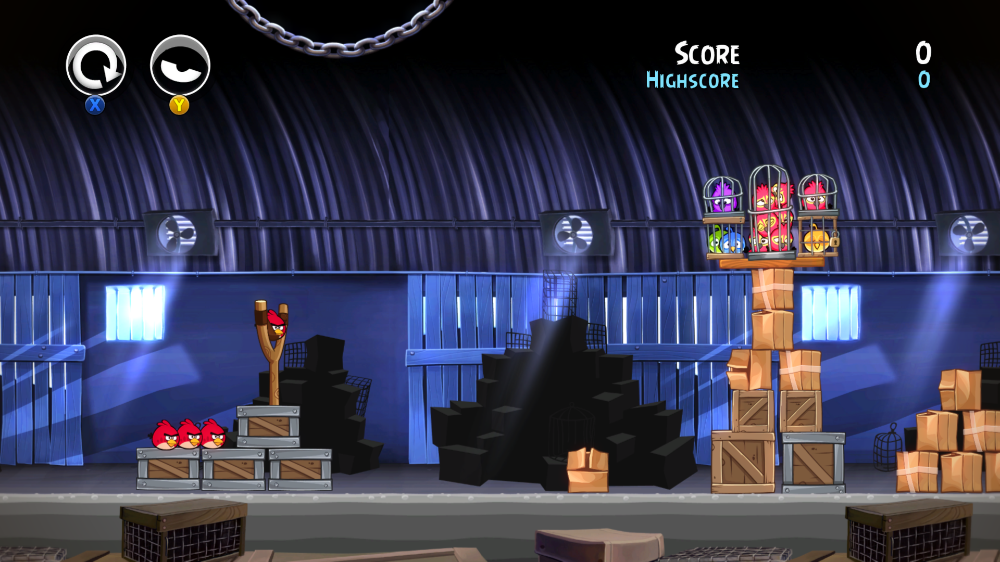

<p align="center">
  
  
  
</p>

<h1 align="center">rehatched-nx</h1>

<p align="center">A Nintendo Switch port of Angry Birds Trilogy for the Xbox 360</p>

This is a Switch port of the Xbox 360 version of Angry Birds Trilogy (Classic, Seasons and Rio). It's a static
recompilation, so the game's PowerPC code gets translated to ARM C++ ahead of time and compiled into a normal `.nro`. It
isn't an emulator. NO GAME FILES ARE INCLUDED! You need your own copy of the game, and everything made from it is made on
your own computer.

## Where it's at

It works on the Switch. The screenshots up top are straight off my console. The title screen, the menus and the
levels all play, with the backgrounds drawn, and it runs on PC (Linux, Vulkan) at 60fps too.

The first console runs turned up three bugs, all fixed now:
- a crash at the end of level 1 (the game asks the renderer for a vertex declaration's elements, and it didn't have an
  answer)
- black level backgrounds (the game resolves through an internal function the renderer didn't hook, and it keeps
  re-pointing one of its depth surfaces)
- A/B and X/Y being swapped

I have only played through a little bit of Classic and Seasons, and I have yet to find any issues with backgrounds, fps or assets. If you find anything, please let me know, and I'll get it fixed. To the best of my knowledge, however, the whole game runs 100%.

All the details, addresses and test runs are in [docs/rehatched-notes.md](docs/rehatched-notes.md).

This technically *does* have support for Angry Birds Space like the Re-Hatched collection supports. I didn't add it
because I didn't feel like integrating another 6.8gb ISO file into this project. I left some functionality there; the
calls and graphics should not be too far off from the other 3 games from Angry Birds Trilogy. It just isn't built or
included. If you would like to compile it as well, my guess is it would either have to be a separate .NRO file, or you
would have to make a launcher app to switch between the two. I don't care enough for it. If you do get it working,
please do not hesitate to let me know, I'd be interested to see it working.

## What you need

- Linux. I built it on CachyOS and haven't tried anything else.
- clang, cmake, ninja and Python 3, plus `pip install xxhash pillow`
- [devkitPro](https://devkitpro.org/wiki/Getting_Started) with the Switch packages:
  `sudo dkp-pacman -S switch-dev switch-portlibs deko3d uam`
- Your own Angry Birds Trilogy disc image (title ID `415608E4`)
- A Switch with custom firmware (Atmosphère) to actually play it

## Before the first build

**DXC.** The shader translator needs Microsoft's DXC, and only its headers are in the repo. Clone
[renderbag/dxc-bin](https://github.com/renderbag/dxc-bin) and copy `bin/x64/dxc-linux` and `lib/x64/libdxcompiler.so`
into the same folders under `app/thirdparty/reblue-XenosRecomp/thirdparty/dxc-bin/`.

**The host tools.** Install SPIRV-Cross from your package manager (`spirv-cross` on Arch), then build glslangValidator
and uam:

```bash
cmake -S sdk/thirdparty/glslang -B out/glslang -G Ninja -DCMAKE_BUILD_TYPE=Release -DENABLE_OPT=OFF \
  -DGLSLANG_TESTS=OFF -DENABLE_GLSLANG_BINARIES=ON -DENABLE_HLSL=OFF -DGLSLANG_ENABLE_INSTALL=OFF \
  -DCMAKE_POLICY_VERSION_MINIMUM=3.5
cmake --build out/glslang --target glslangValidator
bash tools/deko3d_build_tools.sh
```

The last one builds uam and links your spirv-cross into `out/deko3d_tools`, which is where the shader steps look.

## Building

**1. Extract the game**

```bash
python3 tools/extract_iso.py "Angry Birds Trilogy.iso" -o ~/birds/game
ln -s ~/birds/game app/assets
```

**2. The code generator**

```bash
cd sdk
cmake -B build-host -G Ninja -DCMAKE_BUILD_TYPE=Release
cmake --build build-host --target rexglue
cd ..
```

**3. Generate the code from the game**

```bash
bash tools/codegen.sh
python3 tools/post_codegen.py
```

That puts the generated C++ in `app/generated`. Never commit it, it's made from the game.

**4. Dump the shaders**

```bash
python3 tools/renut_shader_dump.py --image out/renut_image.bin --out out/renut_shader_dump
```

**5. The PC build**

You need this even for the Switch build, because it builds the shader translator the next step uses. It has to go in
`app/out/pc`:

```bash
cmake -S app -B app/out/pc -G Ninja -DCMAKE_BUILD_TYPE=Release -DREXSDK_DIR="$PWD/sdk" \
  -DREXGLUE_USE_VULKAN=ON -DREXGLUE_USE_D3D12=OFF
cmake --build app/out/pc -j$(nproc)
```

You can play it on PC from there too.

**6. The Switch shaders**

```bash
bash tools/switch_shaders.sh
```

**7. The Switch build**

```bash
cmake -S app -B app/out/switch -G Ninja -DCMAKE_BUILD_TYPE=Release -DREXSDK_DIR="$PWD/sdk" \
  -DCMAKE_TOOLCHAIN_FILE="$PWD/tools/switch/cmake/switch-devkitA64.cmake"
cmake --build app/out/switch -j$(nproc)
```

You end up with `app/out/switch/renut.nro`.

## Putting it on your Switch

```text
sdmc:/switch/rehatched-nx/
├── rehatched-nx.nro     (app/out/switch/renut.nro, renamed)
└── game_root/           (everything extract_iso.py extracted)
```

Open it from hbmenu. Hold R while opening an installed game so it gets full RAM, applet mode doesn't give it enough.
The first time it runs it makes `rehatched.toml` next to the NRO, that's where your settings go.

## Settings

The ones worth knowing about in `rehatched.toml`:

- `input_xbox_layout = false` is the default, so the buttons go by the letters on the Switch (A is A). Set it to `true`
  if you want them by position like an Xbox pad.
- `rehatched_keep_unused_targets` keeps depth targets around when the game re-points them between views. This is the
  black background fix, so leave it on.
- `banjo_renut_smaa` turns SMAA anti-aliasing on or off.

## How it was made

It's built on [renut_nx_ultimate_base](https://github.com/ChanseyIsTheBest/renut_nx_ultimate_base), which is
ChanseyIsTheBest's Beautiful Katamari port with every renut port's fixes in it. The work was mostly moving the
renderer's Direct3D hooks and device offsets over to the Xbox 360 dev kit version Angry Birds Trilogy was built with
(2.0.9407.0), which is newer than Katamari's. The PC recomp side came from
[TekRantGaming's Re-Hatched Collection](https://github.com/TekRantGaming/angry-birds-re-hatched-collection).

## Credits

- **[TekRantGaming](https://github.com/TekRantGaming/angry-birds-re-hatched-collection)**: the Angry Birds Re-Hatched
  Collection PC recompilation.
- **[ChanseyIsTheBest](https://github.com/ChanseyIsTheBest)**: renut_nx_ultimate_base, renut-nx and the other renut
  Switch ports (katamari-nx, kameo-nx, sasrt-nx, sa2-nx, bangaio-nx).
- **[masterspike52](https://github.com/masterspike52/reNut)**: reNut and its Direct3D-level renderer.
- **[Tom Clay](https://github.com/rexglue/rexglue-sdk)**: the ReXGlue SDK.
- **[Ben Vanik and the Xenia project](https://xenia.jp)**: the research everything here is built on.
- **[hedge-dev](https://github.com/hedge-dev/XenosRecomp)**: XenosRecomp, the shader translator.
- **[fincs and devkitPro](https://devkitpro.org)**: deko3d, uam, libnx and devkitA64.
- **[StevensND](https://github.com/StevensND/nfsmw-nx)**: nfsmw-nx and the SDK's Switch layer.
- **[nebadasSwifty](https://github.com/nebadasSwifty/masseffect-nx)**: masseffect-nx.
- **[KhronosGroup](https://github.com/KhronosGroup)**: SPIRV-Cross.
- cznn999 (dishonored-nx), Thorhax (mk9-nx), VasilkovND (ds3-nx) and LostOdysseyRecomp, whose fixes are in the base.
- The libraries in [THIRD_PARTY_NOTICES.md](THIRD_PARTY_NOTICES.md).

## AI disclosure

This was made with the help of both Claude Code and Google Antigravity. They did a great job, and this project could
not have been done without them. I looked over all of the code they both implemented, and you should do the same if you
are cautious. This repository remains 100% open source, and any issues that may arise will be worked on and
implemented.

## Legal

I'm not affiliated with Rovio, Activision, Microsoft or Nintendo. This repo has no game files and no code generated
from the game. You have to supply your own, and everything made from it (`app/generated`, the shaders) is made on your
own computer. Running homebrew needs custom firmware, which is against Nintendo's terms and can get your console
banned. That's up to you.

`app/`, `tools/` and `docs/` are GPL-3.0 (see [LICENSE](LICENSE)). The SDK is BSD-3-Clause, and the shaders and plume
are MIT ([THIRD_PARTY_NOTICES.md](THIRD_PARTY_NOTICES.md) has all of it).
